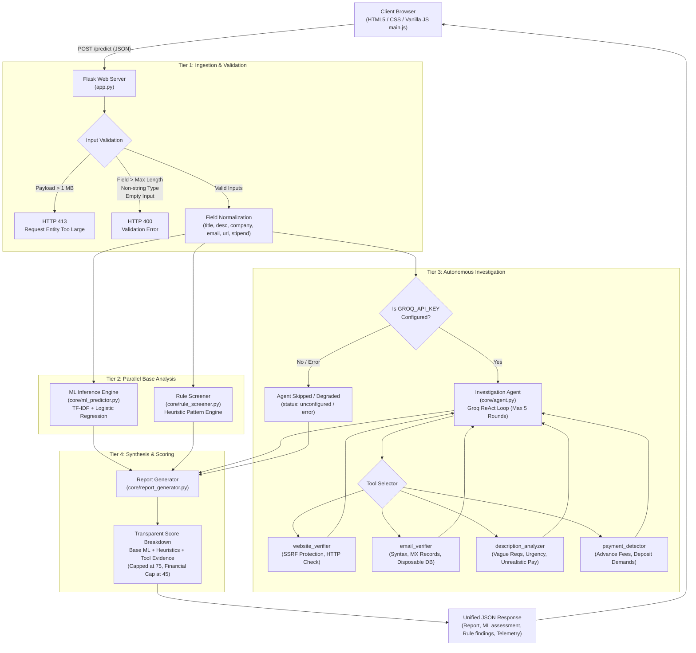

# InternGuard AI — System Architecture & Technical Specification

## 1. System Overview

**InternGuard AI** is a multi-tier, explainable fake internship detection and verification system. It combines three layers of analysis:
1. **Statistical Machine Learning**: A TF-IDF vectorizer + Logistic Regression classifier trained on job posting corpora (EMSCAD).
2. **Deterministic Heuristic Screening**: Regular-expression and keyword-based rule engines for detecting scam patterns (advance fees, telegram recruitment, unrealistic stipends).
3. **Autonomous Agentic Investigation**: A ReAct-style LLM agent (powered by Groq Llama-3.3-70b) equipped with verification tools to inspect recruiter emails, company websites, job descriptions, and fee requests.
4. **Evidence-Based Report Generator**: An aggregation engine that synthesizes findings into a bounded (0–100) risk score with transparent arithmetic, actionable recommendations, and explicit unverified items.

---

## 2. End-to-End Request Workflow

The diagram below illustrates the end-to-end dataflow from the client UI to the Flask backend and analysis components:



---

## 3. Component Details

### 3.1 Tier 1: Input Validation & Early Rejection
All incoming JSON payloads undergo defensive checks before any analysis:
- **Maximum Request Body Size**: Enforced at `1 MB` via Flask `MAX_CONTENT_LENGTH`. Requests exceeding this size are rejected at the WSGI layer with HTTP 413.
- **Field-Level Maximum Character Limits**:
  - `title`: 200 characters
  - `location`: 200 characters
  - `description`: 20,000 characters
  - `requirements`: 10,000 characters
  - `company_name`: 200 characters
  - `contact_email`: 320 characters
  - `company_url`: 2,048 characters
  - `stipend`: 200 characters
- **No Silent Truncation**: Inputs exceeding permitted limits return HTTP 400 detailing the field, maximum allowed length, and actual received length. Downstream ML models, heuristic engines, and LLM agent are never called on invalid payloads.

### 3.2 Tier 2: Statistical ML Inference (`core/ml_predictor.py`)
- **Vectorizer**: Pre-fitted `TfidfVectorizer` (5,000 max features, sublinear TF scaling, English stop-words).
- **Classifier**: Pre-trained `LogisticRegression` model with balanced class weights.
- **Input Text Construction**: Combines `title`, `location`, `description`, and `requirements` into a single text representation using deterministic text cleaning (lowercasing, URL normalization, non-alphanumeric strip).
- **Output**: `prediction` (0 = Legitimate, 1 = Fake), `probability` (0.0 to 1.0), `confidence` percentage, and normalized `combined_text`.

### 3.3 Tier 3: Deterministic Rule Screener (`core/rule_screener.py`)
- Scans job text and stipend fields for known recruitment fraud signatures:
  - **Financial Demands**: Training fee, registration charge, security deposit, laptop fee.
  - **Suspicious Channels**: Telegram interviews, WhatsApp-only hiring, personal payment handles (UPI, PayPal, CashApp, wire).
  - **Unrealistic Claims**: Immediate selection without interview, exorbitant stipends for zero experience.
  - **Payment Negation Handling**: Distinguishes benign disclaimers ("No fees are required") from fraudulent demands ("Pay ₹500 for registration").

### 3.4 Tier 4: Autonomous Groq Investigation Agent (`core/agent.py`)
- **Engine**: Groq API using `llama-3.3-70b-versatile` (configurable via `GROQ_MODEL`).
- **Architecture**: ReAct loop (Reasoning + Tool Execution) operating under strict safety bounds:
  - Maximum 5 iterative rounds (`MAX_ROUNDS = 5`).
  - History tracking to prevent repetitive tool invocations.
  - Safe error trapping: individual tool failures are captured as observational findings without crashing the loop.
- **Separation of Investigation and Verdict**: The agent acts strictly as an investigative investigator, collecting structured evidence into observations. It does **not** emit final risk scores or verdicts (verdicts belong strictly to Phase 5 Report Generator).

### 3.5 Specialized Verification Tools (`core/tools/`)

1. **`CompanyWebsiteVerificationTool` (`website_verifier.py`)**:
   - Validates URL syntax and scheme (`http`, `https`). Rejects dangerous schemes (`file://`, `ftp://`).
   - **SSRF Protection**: Resolves target hostnames against DNS and blocks:
     - Loopback IPs (`127.0.0.0/8`, `::1`).
     - RFC 1918 private subnets (`10.0.0.0/8`, `172.16.0.0/12`, `192.168.0.0/16`).
     - Cloud metadata endpoints (`169.254.169.254`).
   - Performs bounded HTTP requests with custom timeouts (5s) and redirect re-validation.
   - Treats HTTP 200 as technical reachability, **not** as proof of corporate authenticity.

2. **`EmailVerificationTool` (`email_verifier.py`)**:
   - RFC 5322 regex syntax validation.
   - Domain extraction and DNS MX record lookup (via `dnspython`).
   - Known disposable/temporary email provider blocking (e.g. Mailinator, GuerrillaMail, 10MinuteMail).
   - Public freemail identification (Gmail, Yahoo, Outlook) treated as informational context rather than definitive fraud.

3. **`InternshipDescriptionAnalysisTool` (`description_analyzer.py`)**:
   - Evaluates linguistic patterns for urgency pressure, unrealistic earnings, guaranteed selection, and vague eligibility criteria.
   - Treats brief descriptions cautiously (unverified rather than immediately fraudulent).

4. **`PaymentRequestDetectionTool` (`payment_detector.py`)**:
   - Detects advance fees, laptop security deposits, and non-standard payment routing (crypto, gift cards).
   - Distinguishes genuine fee requests from negative disclaimers ("InternGuard does not charge any application fee").

---

## 4. Evidence-Based Scoring Methodology

The `ReportGenerator` combines statistical, deterministic, and observational signals into an objective **0–100 Risk Score**:

```
Risk Score = Clamp0_100( Base Score + Final Evidence Score )
```

### 4.1 Base Score Composition
- **ML Contribution**: $\text{Fake Probability} \times 20$ (Max 20 points).
- **Rule Screening Contribution**: $\text{Normalized Heuristic Score} \times 20$ (Max 20 points).
- Maximum combined base score: **40 points**.

### 4.2 Evidence Additions & Safety Caps
Individual suspicious indicators identified by tools award points according to calibrated severity:
- **Financial Exploitation**: Demands for registration fees, training charges, or equipment deposits contribute up to **45 points** (capped subtotal).
- **Domain & Contact Failures**: Confirmed domain failures, disposable email domains, or non-existent MX records contribute up to **20 points**.
- **Linguistic Red Flags**: Urgency tactics, guaranteed hiring claims contribute up to **15 points**.
- **Overall Evidence Cap**: The total combined contribution from all investigative evidence is strictly capped at **75 points**.
- **Technical Signals Zero Mitigation**: HTTP 200 reachability or valid MX records award **0.0 negative mitigation points** (a working domain does not prove corporate legitimacy).
- **Fee Disclaimer Suppression**: Explicit "no registration fee" disclaimers suppress isolated keyword false positives without subtracting negative risk points. If an actual payment demand is also present, the demand takes precedence.

### 4.3 Risk Levels & Verdict Thresholds

| Risk Score Range | Risk Level | Final Verdict | Actionable Recommendation |
|---|---|---|---|
| **0 – 30** | **Low Risk** | `LEGITIMATE` | Posting displays standard parameters. Exercise standard safety precautions. |
| **31 – 70** | **Medium Risk** | `SUSPICIOUS` | Posting exhibits inconsistencies or unverified signals. Investigate further before sharing personal data. |
| **71 – 100** | **High Risk** | `LIKELY FAKE` | Posting displays critical red flags (advance fees, disposable contacts, or deception). Do not apply or pay money. |

---

## 5. Security Architecture & Threat Model

1. **Server-Side Secret Management**:
   - `GROQ_API_KEY` is loaded exclusively through server-side environment variables (`.env`).
   - The key is never serialized, logged, or returned in frontend responses.
2. **Server-Side Request Forgery (SSRF) Defense**:
   - URL verification resolves domain IPs via DNS before sending HTTP requests.
   - Requests targeting localhost, internal network ranges, or cloud metadata endpoints are immediately blocked.
   - Redirect targets are re-evaluated against SSRF filters before following.
3. **Denial of Service (DoS) Mitigation**:
   - 1 MB request envelope cap rejects oversized payloads before JSON parsing.
   - Hard maximum character lengths on all 8 input fields prevent memory exhaustion and large token consumption.
   - Agent iteration limit (max 5 rounds) prevents infinite LLM reasoning loops.
   - HTTP client timeouts (5s) prevent slowloris/hanging socket attacks during external verification.

---

## 6. Known Technical Limitations

1. **Reachability vs. Authenticity**: An active website (HTTP 200) or valid MX records confirms domain configuration, not employer identity. Fraudsters can register real domains or reference legitimate public websites.
2. **Offline Mode Dependency**: When `GROQ_API_KEY` is not provided or network is unavailable, the agent degrades gracefully to ML + Heuristics, leaving external signals labeled as `unverified`.
3. **Training Data Distribution**: The underlying ML model was trained on the EMSCAD job dataset. Niche internship descriptions or emerging scam jargon may rely primarily on the heuristic and agentic layers for detection.
